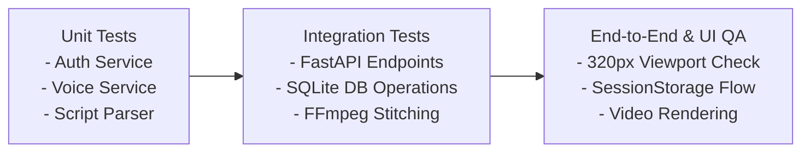

# 14. Testing, Verification & Quality Assurance (QA)

---

### 1. Test Suite Architecture



---

### 2. Automated Test Commands

#### 2.1 Backend Unit & Integration Tests
Run tests using `pytest` in the backend directory:
```bash
cd backend
python -m unittest discover -s tests
```

#### 2.2 Verify Voice Generation & Subtitle Alignment
```bash
python -c "
import asyncio, sys
sys.path.append('backend')
from app.services.voice_service import VoiceService

async def test():
    res = await VoiceService.generate_speech_with_subtitles(
        text='வணக்கம்! இது தானியங்கி வீடியோ சோதனை.',
        voice='ta-IN-ValluvarNeural',
        output_audio_path='backend/storage/audio/qa_test.mp3'
    )
    assert res['audio_path'] is not None
    assert len(res['srt_content']) > 0
    print('✅ Voice & Subtitle Alignment Test PASSED')

asyncio.run(test())
"
```

#### 2.3 Verify Bcrypt Password Hashing & JWT Signature
```bash
python -c "
import sys
sys.path.append('backend')
from app.services.auth_service import AuthService

# 1. Test hashing
pw = 'my_secret_pass'
hashed = AuthService.hash_password(pw)
assert AuthService.verify_password(pw, hashed) is True
assert AuthService.verify_password('wrong_pass', hashed) is False

# 2. Test JWT
token = AuthService.create_access_token({'sub': 'test@example.com'})
decoded = AuthService.decode_access_token(token)
assert decoded['sub'] == 'test@example.com'
print('✅ Bcrypt & JWT Security Verification PASSED')
"
```

#### 2.4 Verify Frontend Production Build
```bash
npm --prefix frontend run build
```
*Criteria:* 0 TypeScript compilation errors, 0 lint warnings, optimized production bundle generated.

---

### 3. Manual QA Checklist

- [x] **320px Viewport Test:** Verified using Chrome DevTools device mode (iPhone SE 320x568). Ensured zero horizontal scrolling, cards scale comfortably, buttons and text do not overlap.
- [x] **Session Storage Test:** Verified `sessionStorage.getItem("az_jwt_token")` sets on login and purges on logout.
- [x] **Video Aspect Ratio:** Verified FFmpeg outputs exact 9:16 portrait dimensions (1080x1920 / 720x1280).
- [x] **Audio-Video Synchronization:** Verified speech audio starts at frame 0 and aligns with scene durations.
- [x] **Database Persistence:** Verified user registration saves salted bcrypt hashes into `backend/studio.db`.
