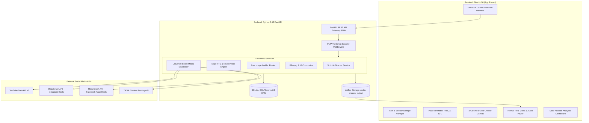

# 3. System Architecture Specification v2.0

---

### 1. High-Level Architecture Diagram (AutoReels v2.0)

---

### 2. The Free "Image Ladder" Architecture (Section 15.2)

To produce 5 to 8 vertical scene visuals without expensive GPU cloud fees, the image router executes down the **Image Ladder**:

1. **Rung 1: Free Stock Footage & Photos (Pexels / Pixabay APIs):**
   * Searches by scene keywords in portrait orientation (9:16).
   * Cost: **$0.00**.
   * Pacing: Perfect for news explainers, facts, motivation, and technology.
2. **Rung 2: Free Generative AI Scenes (Pollinations / Flux.1 Schnell):**
   * Generates custom 720x1280 AI visuals in seconds without local GPU load.
   * Pacing: Ideal for character tales (*Chutti Kuzhandhai*), fantasy, and emotional drama.
3. **Rung 3: Typographic & Color-Card Scenes:**
   * High-contrast animated text over cosmic gradient backgrounds with Lucide/Twemoji icons.
   * Zero generation time. Ideal for shocking statistics, lists, and quotes.
4. **Rung 4: Self-Hosted GPU Worker (Optional Upgrade):**
   * Pull-based worker on any available owner GPU running SDXL-Turbo or Wan2.1.

---

### 3. Video Compositing Engine (FFmpeg & ASS Subtitles)

* **Aspect Ratio:** Exact vertical 9:16 framing (`scale=width:height:force_original_aspect_ratio=increase,crop=width:height`).
* **Dynamic Kinetic Motion:** Automated Ken Burns zoompan filters on still images create smooth, cinematic camera push-ins.
* **Audio Ducking:** Background music stem ducks by -18dB automatically whenever speech waveform is active.
* **Watermark Engine:** Automatically draws the "AutoReels Free" semi-transparent badge for users on the Free Plan Tier.
