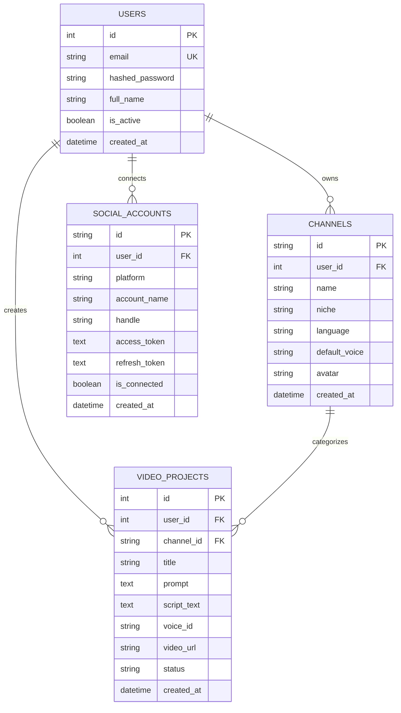

# 4. Database Schema & Persistence Architecture

## Database Engine: SQLite 3 (via SQLAlchemy 2.0 ORM)
**Database File Location:** `backend/studio.db`  
**Migration Path:** Fully portable schema, 100% compatible with PostgreSQL via connection string change.

---

### 1. Entity-Relationship Diagram (ERD)



---

### 2. Table Specifications

#### 2.1 `users`
* `id` (INTEGER, Primary Key, Autoincrement)
* `email` (VARCHAR(255), Unique, Indexed, Not Null)
* `hashed_password` (VARCHAR(255), Not Null) — Salted 12-round bcrypt hash
* `full_name` (VARCHAR(255), Nullable)
* `is_active` (BOOLEAN, Default True)
* `created_at` (DATETIME, UTC timestamp)

#### 2.2 `channels`
* `id` (VARCHAR(100), Primary Key)
* `user_id` (INTEGER, Foreign Key to `users.id`)
* `name` (VARCHAR(255), Channel display title)
* `niche` (VARCHAR(100), e.g., `emotional_drama`, `tech_news`)
* `language` (VARCHAR(50), e.g., `Tamil`, `English`, `Hindi`)
* `default_voice` (VARCHAR(100), e.g., `ta-IN-ValluvarNeural`)
* `avatar` (VARCHAR(10), Emoji or icon key)
* `created_at` (DATETIME)

#### 2.3 `social_accounts`
* `id` (VARCHAR(100), Primary Key)
* `user_id` (INTEGER, Foreign Key to `users.id`)
* `platform` (VARCHAR(50), `youtube`, `instagram`, `facebook`, `tiktok`)
* `account_name` (VARCHAR(255))
* `handle` (VARCHAR(255))
* `access_token` (TEXT, Encrypted OAuth access token)
* `refresh_token` (TEXT, Encrypted permanent refresh token)
* `is_connected` (BOOLEAN, Default True)
* `created_at` (DATETIME)

#### 2.4 `video_projects`
* `id` (INTEGER, Primary Key, Autoincrement)
* `user_id` (INTEGER, Foreign Key to `users.id`)
* `channel_id` (VARCHAR(100), Foreign Key to `channels.id`, Nullable)
* `title` (VARCHAR(255), Video title)
* `prompt` (TEXT, Original story premise)
* `script_text` (TEXT, Full narration text)
* `voice_id` (VARCHAR(100))
* `video_url` (VARCHAR(500), Path to rendered MP4)
* `status` (VARCHAR(50), `draft`, `rendered`, `published`)
* `created_at` (DATETIME)

---

### 3. Session Management & Auto-Table Creation
The database engine automatically verifies and creates all missing tables on application launch:
```python
from app.database import engine, Base
Base.metadata.create_all(bind=engine)
```
Session cleanup is strictly handled via FastAPI's dependency injection (`get_db` generator with `try ... finally: db.close()`).
