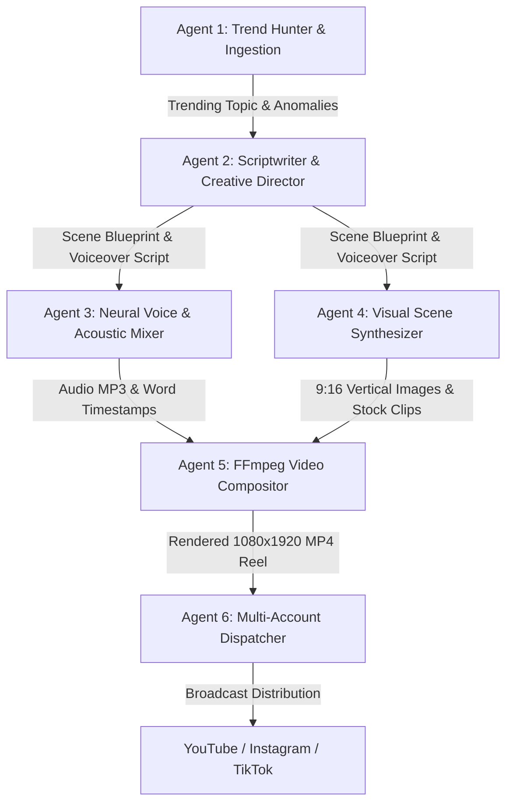

# 6. Multi-Agent AI System Specification

---

### 1. Multi-Agent Director Architecture

The video production pipeline is structured as an orchestrated collaboration between specialized autonomous agents. Each agent possesses a single responsibility, deterministic JSON inputs/outputs, and strict guardrails.



---

### 2. Agent Responsibilities & Prompt Specifications

#### Agent 1: Trend Hunter & Ingestion Agent
* **Role:** Polls Google Trends RSS, Reddit viral feeds (`r/todayilearned`, `r/technology`), and local news feeds.
* **Filter:** Calculates viral velocity (upvotes/hour, regional search breakout %). Emits raw headlines with contextual summaries.

#### Agent 2: Scriptwriter & Creative Director Agent
* **Role:** Formats the premise into a 45-second high-retention narrative.
* **System Prompt:**
  ```text
  You are an expert viral short-form director. Format your output into strict JSON:
  - 0-3s Hook: High curiosity gap, bold provocative question.
  - 4-40s Body: 4 to 6 rapid scenes, visual descriptions with emotional pacing.
  - 40-55s Payoff: Surprise conclusion and comment-triggering CTA.
  Emits: title, language, voice_id, full_narration, scenes array, hashtags.
  ```

#### Agent 3: Neural Voice & Acoustic Mixer Agent
* **Role:** Interfaces with Microsoft Edge-TTS and calculates exact millisecond boundaries per word. Emits volume ducking parameters (-18dB on speech trigger).

#### Agent 4: Visual Scene Synthesizer Agent
* **Role:** Directs visual styling (3D Pixar animation for emotional character tales, cinematic hyperrealistic for geopolitics, cyberpunk neon for tech news). Dispatches requests to Pollinations Flux.1 or Pexels API.

#### Agent 5: FFmpeg Video Compositor Agent
* **Role:** Automates video timeline assembly. Stitches images, scales to 9:16 portrait (1080x1920), burns bouncing kinetic typography (`#FFD700` neon yellow with karaoke pop), and produces the final MP4.

#### Agent 6: Multi-Account Social Dispatcher Agent
* **Role:** Connects to YouTube Data API v3 and Meta Graph API. Appends platform-specific tags (e.g. `#Shorts` for YouTube, clean hashtags for Instagram) and manages scheduled posting.
