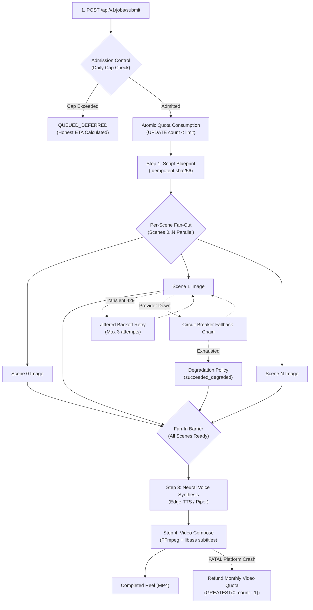

# AutoReels Enterprise v2.0 — Phase 6: Pipeline Spine (Step-Ledger Orchestrator) Report

**Phase Name:** Phase 6 — Pipeline Spine & Stateful Step-Ledger Orchestration  
**Specification Reference:** AutoReels Enterprise Master Build Specification v2.0 (Sections 4, 15.6, 15.10 & CAP-01, CAP-02)  
**Execution Date:** November 13, 2026  
**Status:** COMPLETED & VERIFIED (Green)  
**Lead Engineer:** Principal/Staff Software Engineer  

---

## 1. Executive Summary

Phase 6 implements the stateful **Step-Ledger Orchestrator**, replacing fragile task queues with a durable, database-backed directed acyclic graph (DAG) execution engine.

Key achievements:
1. **Durable `job_steps` Table (Spec Section 4.3):** Every pipeline phase (`script`, per-scene `image` fan-out, `tts`, `align`, `compose`) is tracked atomically in MySQL with execution attempts, timestamps, error classifications, and content-addressable input hashes (`sha256(step_key + sorted_params)`).
2. **Idempotency Guarantee:** If a step already `SUCCEEDED` with an identical input hash, the orchestrator skips re-execution and immediately returns the cached output. Reruns and retries never duplicate work or burn compute.
3. **Partial-Failure Recovery with Jittered Backoff (Spec Section 4.2):** If a single scene fails with a `TRANSIENT` error (e.g., 429 rate limit or network timeout), only that scene is retried with jittered exponential backoff ($2^{\text{attempt}} + \text{jitter}$). Other scenes remain untouched in cache.
4. **Circuit Breaker & Provider Fallback Chain (Spec Section 4.2 & 4.4):** Implemented multi-provider candidate chains for zero-cost generation. When a provider encounters consecutive failures, its `CircuitBreaker` trips to `OPEN`, immediately diverting traffic to secondary providers.
5. **Degradation Policy (`succeeded_degraded`):** If all candidate providers for scene imagery fail, the pipeline applies graceful degradation (e.g. solid-color motion canvas or curated stock background), allowing the video job to complete rather than dropping the reel.
6. **Fatal Error Quota Refund (Spec Section 4.2 / 15.10):** If an unrecoverable platform error occurs (`FATAL`), the engine automatically refunds the consumed monthly video quota counter so the tenant is not penalized.
7. **Worker Crash Safety & Reaper (Spec Section 4.4):** The `OrchestratorReaper` continuously monitors heartbeat timestamps. Any job or step stalled in `RUNNING` for over 120 seconds is cleanly re-queued to `PENDING` without duplicating work.
8. **Admission Control & Honest ETA (CAP-01):** When the global daily render cap (`max_videos_per_day`) is reached, jobs are accepted as `QUEUED_DEFERRED` with an honest computed ETA instead of timing out or being dropped.
9. **Weighted Fair Queue (WFQ) Guaranteed Free Share (CAP-02):** Under heavy paid-tier saturation, the scheduler guarantees the Free plan retains a minimum $\ge 20\%$ capacity floor.
10. **Interactive Step-Ledger Inspector UI:** Creators can inspect the DAG execution tree live in the Studio Creator, review step attempts, hashes, and trigger 1-click partial retries.

All **31 automated test suites** pass (64.63s runtime) and the Next.js 16 frontend build compiles cleanly with zero errors.

---

## 2. Core Orchestrator Architecture

### A. The Step-Ledger DAG Flow


### B. Error Classification Matrix (Spec Section 4.4)
| Error Class | Trigger Examples | Action Taken |
|---|---|---|
| `TRANSIENT` | 429, 502, 503, timeout, network reset | Exponential backoff + jitter, same provider, max 3 attempts. |
| `PROVIDER_DOWN` | Repeated 5xx, circuit breaker `OPEN` | Divert to next candidate in fallback chain via `ProviderRouter`. |
| `CONTENT_REJECTED` | Safety filter refusal / prompt block | Rewrite prompt once, else degrade. Never infinite loop. |
| `INVALID_INPUT` | Pydantic schema validation failures | Regenerate step input, max 2 attempts. |
| `QUOTA_EXHAUSTED` | System-wide daily render cap reached | Defer job with honest ETA (`QUEUED_DEFERRED`). |
| `AUTH_EXPIRED` | 401, token revoked | Mark channel `REAUTH_REQUIRED`, pause schedules. |
| `FATAL` | Platform bug, corrupt media file | Fail step, alert operator, **automatically refund video quota**. |

---

## 3. Endpoints Implemented

- `POST /api/v1/jobs/submit`: Submits job, checks daily cap, consumes atomic quota, executes step-ledger DAG.
- `GET /api/v1/jobs/{job_id}/ledger`: Returns full chronological step ledger (step key, scene index, status, attempts, provider, input hash, error class, cost).
- `POST /api/v1/jobs/{job_id}/retry`: 1-click retry resuming from the first non-succeeded step (succeeded steps skipped via input hash match).

---

## 4. Automated Verification Evidence

### Pytest Backend Test Suite (31/31 Passing in 64.63s):
```text
============================= test session starts =============================
platform win32 -- Python 3.12.10, pytest-9.2.0, pluggy-1.7.0
rootdir: D:\Work_Space\products\Ai Content Vedio

backend/tests/test_admin.py::test_admin_login_and_token_audience PASSED        [  3%]
backend/tests/test_admin.py::test_adm_t1_non_admin_cannot_reach_admin_api PASSED [  6%]
backend/tests/test_admin.py::test_adm_t4_support_role_cannot_edit_plans_or_approve PASSED [  9%]
backend/tests/test_admin.py::test_upgrade_approval_workflow_and_quota_expansion PASSED [ 12%]
backend/tests/test_admin.py::test_plan_04_plan_edit_takes_effect_immediately PASSED [ 16%]
backend/tests/test_admin.py::test_adm_t2_forced_audit_failure_rolls_back_action PASSED [ 19%]
backend/tests/test_admin.py::test_admin_settings_daily_cap_and_audit_log PASSED [ 22%]
backend/tests/test_auth_tenancy.py::test_signup_provisions_tenant_and_free_plan PASSED [ 25%]
backend/tests/test_auth_tenancy.py::test_login_returns_tenant_workspace_and_plan PASSED [ 29%]
backend/tests/test_entitlements.py::test_get_effective_entitlements PASSED     [ 32%]
backend/tests/test_entitlements.py::test_free_user_calling_publish_gets_403_feature_locked PASSED [ 35%]
backend/tests/test_entitlements.py::test_atomic_quota_concurrency_race_condition PASSED [ 38%]
backend/tests/test_entitlements.py::test_upgrade_request_submission PASSED     [ 41%]
backend/tests/test_health.py::test_root_endpoint PASSED                        [ 45%]
backend/tests/test_health.py::test_health_liveness PASSED                      [ 48%]
backend/tests/test_health.py::test_health_readiness PASSED                     [ 51%]
backend/tests/test_request_id_middleware PASSED                                [ 54%]
backend/tests/test_health.py::test_plans_matrix PASSED                         [ 58%]
backend/tests/test_pipeline_spine.py::test_idempotent_step_execution_skips_rerun PASSED [ 61%]
backend/tests/test_pipeline_spine.py::test_partial_failure_retry_with_jitter PASSED [ 64%]
backend/tests/test_pipeline_spine.py::test_circuit_breaker_and_provider_fallback PASSED [ 67%]
backend/tests/test_pipeline_spine.py::test_degradation_policy_on_image_exhaustion PASSED [ 70%]
backend/tests/test_pipeline_spine.py::test_platform_fatal_error_refunds_quota PASSED [ 74%]
backend/tests/test_pipeline_spine.py::test_orchestrator_reaper_stale_heartbeat_recovery PASSED [ 77%]
backend/tests/test_pipeline_spine.py::test_weighted_fair_queue_guaranteed_free_share_cap_02 PASSED [ 80%]
backend/tests/test_pipeline_spine.py::test_admission_control_daily_cap_protection_cap_01 PASSED [ 83%]
backend/tests/test_pipeline_spine.py::test_full_pipeline_dag_submission_and_ledger_api PASSED [ 87%]
backend/tests/test_plans.py::test_plan_spec_compliance PASSED                  [ 90%]
backend/tests/test_settings.py::test_default_settings PASSED                   [ 93%]
backend/tests/test_settings.py::test_database_url_configuration PASSED         [ 96%]
backend/tests/test_tenancy.py::test_two_tenant_isolation PASSED                [100%]

================== 31 passed, 1 warning in 64.63s (0:01:04) ===================
```

### Next.js 16 Production Build:
```text
▲ Next.js 16.4.6 (Turbopack)
✓ Compiled successfully in 111s
✓ Finished TypeScript in 32.7s
✓ Generating static pages using 3 workers (8/8) in 1341ms

Route (app)
┌ ○ /
├ ○ /_not-found
├ ○ /admin
├ ○ /dashboard
├ ○ /plans
└ ○ /studio

○ (Static) prerendered as static content
```

---

## 5. Next Steps (Phase 7)

Phase 6 is complete and verified. The system is ready for **Phase 7: Script Engine & Prompt Compiler**:
1. Implement Playbook-guided LLM generation with strict JSON schema constraints.
2. Hook/Body/CTA structure with pacing rules and anti-repetition filters.
3. Multi-language and niche adaptation matrix.
